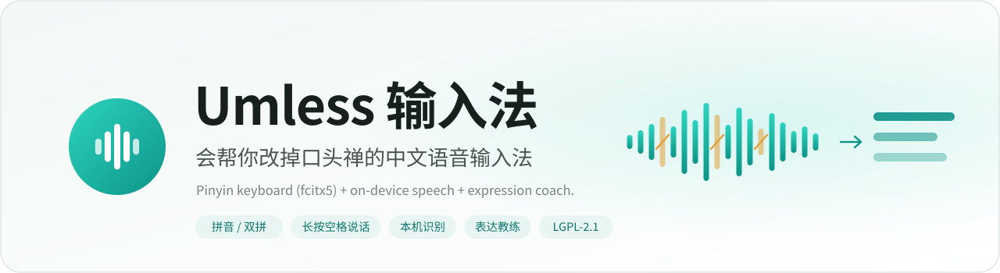
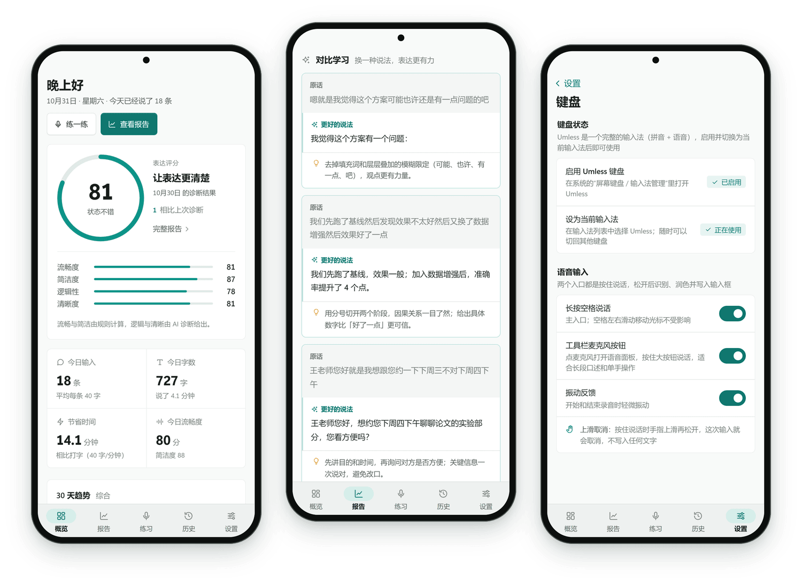
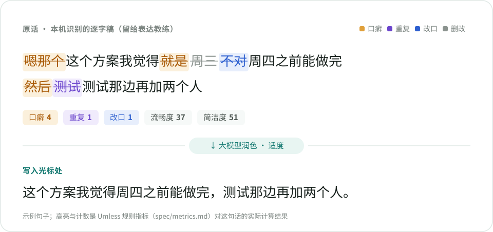
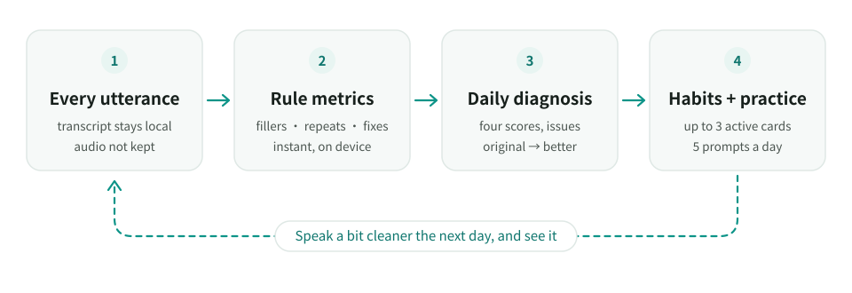
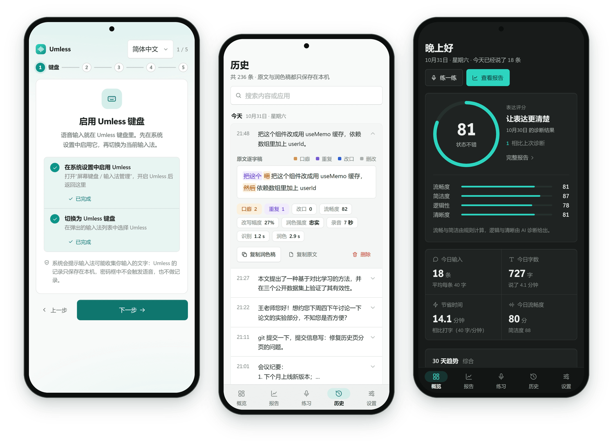

  <picture>
    <source media="(prefers-color-scheme: dark)" srcset="docs/assets/readme/banner-android-dark.svg">
    
  </picture>

  <a href="README.md">简体中文</a> · <b>English</b>

  
  
  
  
  

The Android app of [Umless](https://github.com/despriber/Umless), an open-source voice input tool that helps you drop your filler words.
It is a fork of [fcitx5-android](https://github.com/fcitx5-android/fcitx5-android): the keyboard and the Pinyin / Shuangpin / Wubi input methods come from upstream; Umless adds dictation and an expression coach on top.

  

- **Long-press the space bar to talk**: on release, fillers are removed, errors fixed and the text formatted and inserted at the cursor; slide up to cancel, and switch back to the original words or undo after inserting. Recognition runs on the phone (sherpa-onnx + SenseVoice).
- **Polishing uses your own LLM**: any OpenAI-compatible API, with the same prompts as the desktop app.
- **The main app is the same as on desktop**: overview, daily diagnosis and habit cards, speaking practice, history, settings.
- **Your data stays on the phone**: recordings are not kept, history lives in a local database.
- Application ID `org.umless.ime`, so it can be installed next to the original fcitx5-android.

> [!NOTE]
> This is a beta (arm64 only). Please report problems in this repository; Settings → About → Export diagnostic log exports a log without your text or API key.

The UI is available in Simplified Chinese and English; the screenshots use Chinese sample data because Umless is Chinese-first.

  <picture>
    <source media="(prefers-color-scheme: dark)" srcset="docs/assets/readme/before-after-dark.svg">
    
  </picture>

## Dictation

It is a complete Chinese keyboard first: Pinyin, Shuangpin, candidates, clipboard and themes all come from fcitx5-android. Voice is added on top:

| Action | Result |
|---|---|
| Long-press space | Starts recording; "Listening", a waveform and a timer appear above the keyboard. Sliding on space to move the cursor still works |
| Release | Recognising → polishing → inserted at the cursor (committed directly, no clipboard) |
| Slide up while holding | Shows "release to cancel"; nothing is inserted |
| Tap "Original / Undo" after inserting | Switch to the raw transcript, or remove what was just inserted |
| Toolbar mic | Opens a voice panel with a big hold-to-talk button for longer dictation |

- **Scene-aware polishing** from the app's package name and the field type: chat, document, email, search / URL. Search and URL fields always use the faithful level, without paragraphs.
- **Recognition runs in its own `:voice` process**, so a native crash can't take the keyboard down; the model is released after being idle for a while.
- **Fallback**: if the LLM times out, isn't configured or there is no network, the raw transcript is inserted and you are told so.
- **The model isn't bundled**: it is downloaded in the app on first use (~166 MB) and verified with sha256.

## Privacy

- **Password fields**: long-press space never starts voice input, the mic button is hidden, nothing is recorded.
- **Incognito fields** (e.g. a private browser tab): typing works as usual, nothing is recorded.
- **App blocklist**: common password managers and banking / payment apps by default; edit it as you like.
- Recordings are not kept; transcripts only live in the local database, with pause, retention period, export and wipe.
- Upstream fcitx5-android has no network permission; Umless adds it only to reach the LLM endpoint you configure, download the recognition model and check for updates. No telemetry.

## Expression coach

The main app is the desktop's web UI in a WebView (with a bottom tab bar on phones), and its statistics and scores are identical to the desktop: both use [`spec/` in the main Umless repository](https://github.com/despriber/Umless/tree/main/spec), copied in at build time, and the `umless-core` unit tests run every golden case (63 metric, 120 score, 13 prompt-assembly and 39 ASR post-processing cases), comparing floats as exact doubles.

  <picture>
    <source media="(prefers-color-scheme: dark)" srcset="docs/assets/readme/coach-loop-en-dark.svg">
    
  </picture>

- **Rule metrics**: fillers, repetitions and self-corrections are counted locally, right away; only what the polish removed counts.
- **Daily diagnosis**: fluency and concision (rules) plus logic and clarity (LLM), issues and advice, and "original → better" examples. It runs when you open the app, never inside the keyboard process.
- **Habit cards** turn measurable issues into baseline → current → target progress.
- **Speaking practice**: 5 prompts a day, recorded inside the app, with five scores and a model answer.

  

## Install and update

Download `Umless-<version>-arm64.apk` from [Releases](https://github.com/despriber/Umless-Android/releases/latest) (arm64 only for now, which covers most phones). The first install needs "Install unknown apps" permission. Then follow the onboarding: enable the keyboard, grant the microphone, download the recognition model (~166 MB) and set up your LLM.

- **In-app updates**: when you open the app and the last check is more than a day old it checks for a new version (Settings → About to check manually or turn it off). Downloads are verified (file hash and signing certificate) before installing over the current version through the system installer; your data is kept. Only a manifest on GitHub Releases is read; nothing is uploaded.
- **Obtainium**: add `https://github.com/despriber/Umless-Android` in [Obtainium](https://github.com/ImranR98/Obtainium), set the APK filter regex to `arm64\.apk$`, and leave pre-releases unchecked.
- Signing certificate SHA-256: `AF:19:0F:91:1E:AA:73:48:FD:B7:1B:6B:C8:00:BE:1F:0A:52:34:57:31:14:A6:0C:9D:6B:4B:3F:EB:05:B8:12`. APKs signed with a different certificate are not official builds, and in-app updates refuse to install them.

Development and building: [umless/ARCHITECTURE.md](umless/ARCHITECTURE.md) (needs the main Umless repository at `../Umless`); releasing: [RELEASING.md](RELEASING.md).

## License and credits

- This repository is a fork of [fcitx5-android](https://github.com/fcitx5-android/fcitx5-android) (Copyright Fcitx5 for Android Contributors) and, like upstream, is released under [LGPL-2.1-or-later](LICENSE). Umless is not affiliated with the upstream project; please report issues here, not upstream.
- The input method framework and engines come from [Fcitx5](https://github.com/fcitx/fcitx5), [libime](https://github.com/fcitx/libime), [fcitx5-chinese-addons](https://github.com/fcitx/fcitx5-chinese-addons), [fcitx5-lua](https://github.com/fcitx/fcitx5-lua) and others, each under its own license; the full list of dependencies and licenses is on the open-source licenses page in fcitx5's original settings inside the app (Settings → About → Advanced keyboard settings).
- Speech recognition uses [sherpa-onnx](https://github.com/k2-fsa/sherpa-onnx) (Apache-2.0). The model is not shipped in the APK; it is downloaded from the official sherpa-onnx releases on first use. SenseVoice-Small is under the [FunASR Model License](https://github.com/modelscope/FunASR/blob/main/MODEL_LICENSE) (FunAudioLLM / Alibaba Tongyi Lab).
- Thanks to all contributors of fcitx5-android and the Fcitx community.

The original upstream fcitx5-android README is kept at the end of [README.md](README.md#上游说明fcitx5-android); its download links, signatures and community channels belong to upstream fcitx5-android, not Umless.
