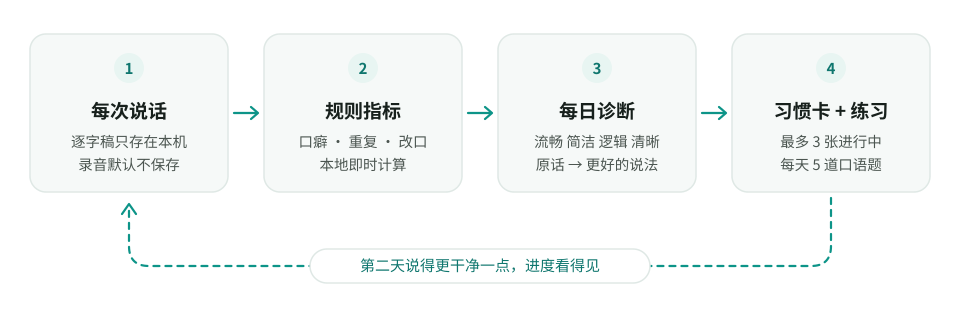

<p align="center">
  <picture>
    <source media="(prefers-color-scheme: dark)" srcset="docs/assets/readme/banner-android-dark.svg">
    
  </picture>
</p>

<p align="center">
  <b>简体中文</b> · <a href="README.en.md">English</a>
</p>

<p align="center">
  <a href="https://github.com/despriber/Umless-Android/releases/latest"></a>
  
  <a href="LICENSE"></a>
  <a href="https://github.com/fcitx5-android/fcitx5-android"></a>
  <a href="https://github.com/despriber/Umless"></a>
</p>

会帮你改掉口癖的开源语音输入法，[Umless](https://github.com/despriber/Umless) 的 Android 端。
基于 [fcitx5-android](https://github.com/fcitx5-android/fcitx5-android) 修改：键盘、拼音 / 双拼 / 五笔等输入方式都来自上游，
Umless 在上面加了语音输入与表达教练。

<p align="center">
  
</p>

- **长按空格说话**：松开后自动去口癖、纠错、排版并写入光标处；上滑取消，写入后可换回原话或撤销。识别在手机本地运行（sherpa-onnx + SenseVoice）。
- **润色用你自己的大模型**：任意 OpenAI 兼容接口，提示词与桌面端一致。
- **主 App 与桌面端相同**：概览、每日诊断与习惯卡、口语练习、历史、设置。
- **数据只在本机**：录音不保存，记录存在手机本地数据库。
- 应用 ID `org.umless.ime`，可以和原版 fcitx5-android 同时安装。

> [!NOTE]
> 目前是测试版（仅 arm64）。遇到问题请在本仓库反馈，「设置 → 关于 → 导出诊断日志」可以导出不含原文和 API Key 的日志。

<p align="center">
  <picture>
    <source media="(prefers-color-scheme: dark)" srcset="docs/assets/readme/before-after-dark.svg">
    
  </picture>
</p>

## 语音输入

它首先是一个完整的中文输入法：拼音、双拼、候选栏、剪贴板、主题都来自 fcitx5-android。语音是在这之上加的：

| 操作 | 效果 |
|---|---|
| 长按空格 | 开始录音，键盘上方显示「正在聆听」、声波和计时；空格左右滑动移动光标不受影响 |
| 松开 | 识别中 → 润色中 → 写入光标处（直接写入输入框，不经过剪贴板） |
| 按住时上滑 | 提示「松开取消」，松开后什么都不写 |
| 写入后点「原话 / 撤销」 | 换回识别原文，或删掉刚写入的文字 |
| 工具栏麦克风 | 打开语音面板，按住大按钮说话，适合长段口述和单手操作 |

- **按场景润色**：根据当前 App 的包名和输入框类型判断聊天、文档、邮件、搜索 / 网址等场景；搜索框和网址栏只用「忠实」档、不分段。
- **识别在独立进程**：`:voice` 进程里运行 sherpa-onnx + SenseVoice，原生库出问题不会拖垮键盘；空闲一段时间后自动释放模型内存。
- **失败兜底**：大模型超时、没配置或没网络时，写入识别原文并提示。
- **模型不打包进安装包**：首次使用时在 App 内下载（约 166MB），校验 sha256。

## 隐私

- **密码框**：长按空格不触发语音、隐藏麦克风按钮，不记录。
- **无痕输入框**（如浏览器无痕标签页）：照常输入，但不记录。
- **应用黑名单**：默认包含常见的密码管理器和银行、支付类 App，可以自己增删。
- 录音不保存；逐字稿只存在本机数据库，支持暂停记录、保留天数、导出、清空。
- 上游 fcitx5-android 没有网络权限，Umless 加上了，只用于连接你配置的大模型地址、下载识别模型和检查更新；没有遥测。

## 表达教练

主 App 是桌面端的同一套网页界面（在 WebView 里加载，手机上自动切换为底部标签栏），统计和评分与桌面端完全一致：两端共用 [Umless 主仓库的 `spec/`](https://github.com/despriber/Umless/tree/main/spec)，构建时复制进来，`umless-core` 的单元测试逐条跑全部黄金样例（规则指标 63 条、评分 120 条、提示词拼装 13 条、识别后处理 39 条），浮点数按 double 严格相等。

<p align="center">
  <picture>
    <source media="(prefers-color-scheme: dark)" srcset="docs/assets/readme/coach-loop-dark.svg">
    
  </picture>
</p>

- **规则指标**：口癖、重复、改口在本地即时统计，只有被润色删掉的才算数。
- **每日诊断**：流畅度、简洁度（规则）+ 逻辑性、清晰度（大模型）四项评分，问题与建议，「原话 → 更好的说法」对比示例。诊断在打开 App 时进行，不在键盘进程里跑。
- **习惯卡**：把可以量化的问题变成卡片，追踪「起点 → 当前 → 目标」。
- **口语练习**：每天 5 道题，在 App 内录音，五维评分和示范表达。

<p align="center">
  
</p>

<p align="center"><sub>左起：新手引导（启用键盘）、历史记录中的口癖 / 重复 / 改口高亮、深色主题。截图均为模拟数据。</sub></p>

## 安装与更新

在 [Releases](https://github.com/despriber/Umless-Android/releases/latest) 下载 `Umless-<版本>-arm64.apk` 安装
（目前只提供 arm64，适用于绝大多数手机）。首次安装需要允许「安装未知应用」。打开 App 后按新手引导启用键盘、授权麦克风、下载识别模型（约 166MB）、配置大模型。

- **App 内更新**：每次打开 App 时若距上次检查超过一天就检查一次新版本（「设置 → 关于」可手动检查、关闭自动检查）；
  下载后校验文件和签名，再通过系统安装界面覆盖安装，数据保留。只读取 GitHub Releases 上的更新清单，不上传任何数据。
- **Obtainium**：也可以在 [Obtainium](https://github.com/ImranR98/Obtainium) 里添加 `https://github.com/despriber/Umless-Android`，
  APK 筛选正则填 `arm64\.apk$`，不要勾选预发布版本。
- 签名证书 SHA-256：`AF:19:0F:91:1E:AA:73:48:FD:B7:1B:6B:C8:00:BE:1F:0A:52:34:57:31:14:A6:0C:9D:6B:4B:3F:EB:05:B8:12`。
  证书不同的安装包不是官方版本，App 内更新会拒绝安装。

开发与构建见 [umless/ARCHITECTURE.md](umless/ARCHITECTURE.md)（需要把 Umless 主仓库放在 `../Umless`），发布流程见 [RELEASING.md](RELEASING.md)。

## 和桌面端的关系

| | [Umless（Windows）](https://github.com/despriber/Umless) | Umless 输入法（本仓库） |
|---|---|---|
| 入口 | 任意应用里按住热键 | 长按空格 / 工具栏麦克风 |
| 识别 | SenseVoice（默认）/ Qwen3-ASR / 云端 | SenseVoice（手机本地） |
| 润色、评分、提示词 | 同一套 `spec/` | 同一套 `spec/` |
| 数据 | 本机 SQLite | 手机本地数据库（与桌面端同一 schema），两端不同步 |
| 许可证 | MIT | LGPL-2.1-or-later |

## 许可证与致谢

- 本仓库是 [fcitx5-android](https://github.com/fcitx5-android/fcitx5-android)（Copyright Fcitx5 for Android Contributors）的分支，
  与上游相同以 [LGPL-2.1-or-later](LICENSE) 发布。Umless 与上游项目没有隶属关系，问题请在本仓库反馈，不要提交到上游。
- 输入法框架与引擎来自 [Fcitx5](https://github.com/fcitx/fcitx5)、[libime](https://github.com/fcitx/libime)、
  [fcitx5-chinese-addons](https://github.com/fcitx/fcitx5-chinese-addons)、[fcitx5-lua](https://github.com/fcitx/fcitx5-lua) 等，遵守各自的许可证；
  完整的依赖与许可证列表见 App 里 fcitx5 原有设置中的开源许可页面（入口：设置 → 关于 → 高级键盘设置）。
- 语音识别使用 [sherpa-onnx](https://github.com/k2-fsa/sherpa-onnx)（Apache-2.0）。识别模型不随安装包分发，首次使用时从
  sherpa-onnx 官方 Release 下载：SenseVoice-Small 遵守 [FunASR Model License](https://github.com/modelscope/FunASR/blob/main/MODEL_LICENSE)（FunAudioLLM / 阿里巴巴通义实验室）。
- 感谢 fcitx5-android 与 Fcitx 社区的全部贡献者。

---

以下是上游 fcitx5-android 的原始说明，保留作参考。其中的下载链接、签名信息和社区渠道都属于上游原版 fcitx5-android，不是 Umless。

# 上游说明：fcitx5-android

[Fcitx5](https://github.com/fcitx/fcitx5) input method framework and engines ported to Android.

## Download

[](https://github.com/fcitx5-android/fcitx5-android/releases/latest)
[](https://f-droid.org/packages/org.fcitx.fcitx5.android)
[](https://play.google.com/store/apps/details?id=org.fcitx.fcitx5.android)

You can also download the **latest CI build** on our Jeninks server: [](https://jenkins.fcitx-im.org/job/android/job/fcitx5-android/)

> [!NOTE]
> APKs downloaded from GitHub Release/F-Droid/Jenkins have the same signature, which means they're compatible when upgrading, but Google Play's do not.
> <details>
> <summary>(click here for detailed signature info)</summary>
> <ul>
> <li>Package Name: <code>org.fcitx.fcitx5.android</code></li>
> <li>Certificate SHA-256 fingerprint:</li>
> <ul>
> <li>GitHub Release/Jenkins/F-Droid</li>
> <code>E4:DB:1E:9E:DF:F1:36:29:D0:7D:E4:BB:F8:16:5F:E9:BD:85:57:AB:55:09:26:72:DA:8E:40:DB:E4:84:EC:D7</code>
> <li>Google Play</li>
> <code>06:53:6F:F6:E8:76:C0:14:E1:4B:44:6F:61:FA:2B:80:9E:06:67:39:A1:D1:17:0D:0A:7A:89:88:4C:48:00:33</code>
> </ul>
> </ul>
> </details>

In case you want Fcitx5 on other platforms: [macOS](https://github.com/fcitx-contrib/fcitx5-macos), [iOS](https://github.com/fcitx-contrib/fcitx5-ios), [HarmonyOS](https://github.com/fcitx-contrib/fcitx5-harmony), [ChromeOS](https://github.com/fcitx-contrib/fcitx5-chrome), [Windows](https://github.com/fcitx-contrib/fcitx5-windows); or [try Fcitx5 in the browser](https://fcitx-contrib.github.io/online/index.html)

## Project status

### Supported Languages

- English (with spell check)
- Chinese
  - Pinyin, Shuangpin, Wubi, Cangjie and custom tables (built-in, powered by [fcitx5-chinese-addons](https://github.com/fcitx/fcitx5-chinese-addons))
  - Zhuyin/Bopomofo (via [Chewing Plugin](./plugin/chewing))
  - Jyutping (via [Jyutping Plugin](./plugin/jyutping/), powered by [libime-jyutping](https://github.com/fcitx/libime-jyutping))
- Vietnamese (via [UniKey Plugin](./plugin/unikey), supports Telex, VNI and VIQR)
- Japanese (via [Anthy Plugin](./plugin/anthy))
- Korean (via [Hangul Plugin](./plugin/hangul))
- Sinhala (via [Sayura Plugin](./plugin/sayura))
- Thai (via [Thai Plugin](./plugin/thai))
- Generic (via [RIME Plugin](./plugin/rime), supports importing custom schemas)

### Implemented Features

- Virtual Keyboard (layout not customizable yet)
- Expandable candidate view
- Clipboard management (plain text only)
- Theming (custom color scheme, background image and dynamic color aka monet color after Android 12)
- Popup preview on key press
- Long press popup keyboard for convenient symbol input
- Symbol and Emoji picker
- Plugin System for loading addons from other installed apk
- Floating candidates panel when using physical keyboard

### Planned Features

- Customizable keyboard layout
- More input methods (via plugin)

## Screenshots

|拼音, Material Light theme, key border enabled|自然码双拼, Pixel Dark theme, key border disabled|
|:-:|:-:|
|||

|Emoji picker, Pixel Light theme, key border enabled|Symbol picker, Material Dark theme, key border disabled|
|:-:|:-:|
|||

## Get involved

Trello kanban: https://trello.com/b/gftk6ZdV/kanban

Matrix Room: https://matrix.to/#/#fcitx5-android:mozilla.org

Discuss on Telegram: [@fcitx5_android_group](https://t.me/fcitx5_android_group) ([@fcitx5_android](https://t.me/fcitx5_android) originally)

## Build

### Dependencies

- Android SDK Platform & Build-Tools 35.
- Android NDK (Side by side) 25 & CMake 3.22.1, they can be installed using SDK Manager in Android Studio or `sdkmanager` command line.
- [KDE/extra-cmake-modules](https://github.com/KDE/extra-cmake-modules)
- GNU Gettext >= 0.20 (for `msgfmt` binary; or install `appstream` if you really have to use gettext <= 0.19.)

### How to set up development environment

<details>
<summary>Prerequisites for Windows</summary>

- Enable [Developer Mode](https://learn.microsoft.com/en-us/windows/apps/get-started/enable-your-device-for-development) so that symlinks can be created without administrator privilege.

- Enable symlink support for `git`:

    ```shell
    git config --global core.symlinks true
    ```

</details>

First, clone this repository and fetch all submodules:

```shell
git clone git@github.com:fcitx5-android/fcitx5-android.git
git submodule update --init --recursive
```

Install `extra-cmake-modules` and `gettext` with your system package manager:

```shell
# For Arch Linux (Arch has gettext in it's base meta package)
sudo pacman -S extra-cmake-modules

# For Debian/Ubuntu
sudo apt install extra-cmake-modules gettext

# For macOS
brew install extra-cmake-modules gettext

# For Windows, install MSYS2 and execute in its shell (UCRT64)
pacman -S mingw-w64-ucrt-x86_64-extra-cmake-modules mingw-w64-ucrt-x86_64-gettext
# then add C:\msys64\ucrt64\bin to PATH
```

Install Android SDK Platform, Android SDK Build-Tools, Android NDK and cmake via SDK Manager in Android Studio:

<details>
<summary>Detailed steps (screenshots)</summary>

**Note:** These screenshots are for references and the versions in them may be out of date.
The current recommended versions are recorded in [Versions.kt](build-logic/convention/src/main/kotlin/Versions.kt) file.


</details>

### Trouble-shooting

- Android Studio indexing takes forever to complete and cosumes a lot of memory.

    Switch to "Project" view in the "Project" tool window (namely the file tree side bar), right click `lib/fcitx5/src/main/cpp/prebuilt` directory, then select "Mark Directory as > Excluded". You may also need to restart the IDE to interrupt ongoing indexing process.

- Gradle error: "No variants found for ':app'. Check build files to ensure at least one variant exists." or "[CXX1210] <whatever>/CMakeLists.txt debug|arm64-v8a : No compatible library found"

    Examine if there are environment variables set such as `_JAVA_OPTIONS` or `JAVA_TOOL_OPTIONS`. You might want to clear them (maybe in the startup script `studio.sh` of Android Studio), as some gradle plugin treats anything in stderr as errors and aborts.

## Nix

Appropriate Android SDK with NDK is available in the development shell.  The `gradlew` should work out-of-the-box, so you can install the app to your phone with `./gradlew installDebug` after applying the patch mentioned above. For development, you may want to install the unstable version of Android Studio, and point the project SDK path to `$ANDROID_SDK_ROOT` defined in the shell. Notice that Android Studio may generate wrong `local.properties` which sets the SDK location to `~/Android/SDK` (installed by SDK Manager). In such case, you need specify `sdk.dir` as the project SDK in that file manually, in case Android Studio sticks to the wrong global SDK.
